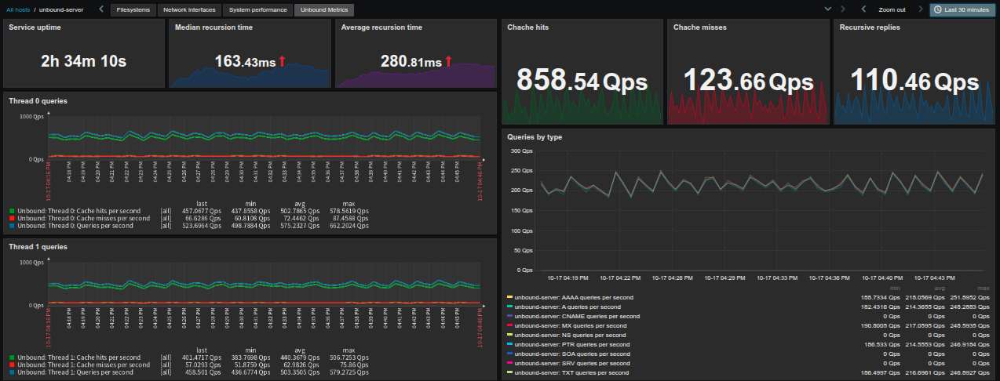
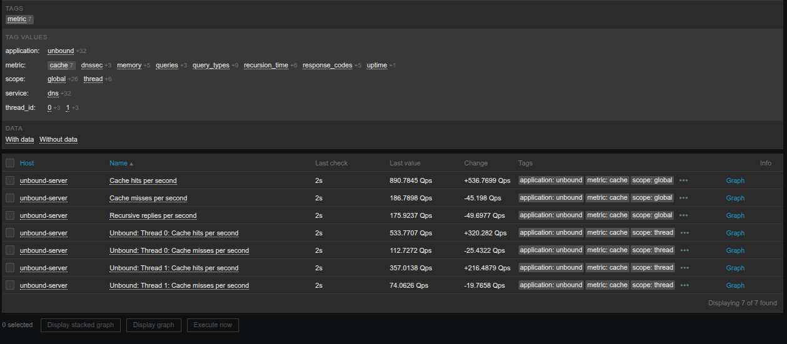

# Unbound DNS Anycast Monitoring with Zabbix

A Zabbix monitoring project for Unbound DNS resolvers in an Anycast environment, featuring a custom monitoring template, a Python-based statistics collector, and a dashboard for operational visibility.

The collector retrieves statistics through `unbound-control`, parses the output into JSON, and exposes the collected metrics through a Zabbix Agent `UserParameter`. The template can use this data to monitor DNS query activity, cache behavior, recursive resolution, DNSSEC validation, request-list utilization, memory usage, and other resolver statistics.

The project also explores DNS health monitoring and Anycast route management through FRRouting (FRR), using OSPF and OSPFv3.

**Project status:** Work in progress.

## Overview

The primary goal is to provide visibility into Unbound DNS resolver behavior through Zabbix.

Key components:

- **Python statistics collector:** Retrieves and parses Unbound statistics into JSON.
- **Zabbix Agent:** Exposes the collector output through a custom `UserParameter`.
- **Zabbix template:** Organizes the collected metrics for monitoring and visualization.
- **Zabbix dashboard:** Provides an operational overview of DNS resolver activity and performance.
- **Unbound:** Recursive DNS resolver being monitored.
- **FRRouting (FRR):** Routing platform for the optional Anycast failover component.

## Dashboard

The Zabbix dashboard provides an overview of Unbound DNS resolver activity, including query statistics, cache performance, recursive resolution, DNSSEC validation, and resource utilization.



## Architecture

The monitoring data flow is:

1. Unbound exposes its statistics through `unbound-control`.
2. The Python collector retrieves and parses the statistics.
3. The collector outputs the resulting metrics as JSON.
4. The Zabbix Agent exposes the JSON through the `unbound.metrics` UserParameter.
5. The Zabbix template collects and organizes the data.
6. The dashboard visualizes relevant operational metrics.

The optional failover component is intended to integrate resolver health checks with FRR route advertisements. Its implementation and operational policies are deployment-specific.

## Requirements

- Linux.
- Unbound DNS resolver.
- `unbound-control` configured and authorized to access the local resolver.
- Python 3.
- Zabbix Agent with support for custom `UserParameter` definitions.
- Zabbix server and frontend.
- FRRouting with OSPF and OSPFv3, if using the optional routing component.

## Unbound Configuration

Enable the required statistics and remote-control functionality in `unbound.conf`:

```conf
server:
    extended-statistics: yes
    statistics-cumulative: no
    statistics-interval: 0

remote-control:
    control-enable: yes
```

Ensure that `unbound-control` is correctly configured and can communicate with the Unbound instance.

Extended statistics provide additional information about DNS query types, response codes, DNSSEC validation, and other resolver activity.

## Zabbix Agent Configuration

Add the following `UserParameter` to the agent configuration:

```conf
UserParameter=unbound.metrics,/usr/local/bin/unbound_collector.py
```

Ensure that the collector is installed at the configured path, has the required execution permissions, and can access `unbound-control`.

Restart or reload the Zabbix Agent as required by the installed version and configuration.

## Statistics Collection

The Python collector retrieves statistics using:

```bash
unbound-control stats_noreset
```

It parses the output and returns a JSON object containing global and per-thread statistics. The resulting data can be used by the Zabbix template to collect metrics covering:

- DNS queries and cache hits or misses.
- Recursive resolution activity and response times.
- DNS response codes.
- DNSSEC validation.
- Request-list utilization and limits.
- UDP, TCP, TLS, and IPv6 query activity.
- Internal cache usage and memory statistics.
- Per-thread resolver activity.

Metric availability depends on the Unbound version and the statistics exposed by the running instance.

## Collected Metrics

The Zabbix Latest data view provides a detailed look at the metrics collected by the template, including their current values and collection status.



## Anycast Health and Failover

The project also explores the integration of resolver health checks with FRRouting. See [heathcheck.sh](scripts/healthcheck.sh).

The intended approach is to withdraw the local Anycast routes when the resolver becomes unhealthy and restore them after recovery. However, health-check criteria, failure thresholds, recovery policies, and route-state validation must be implemented and adapted to the deployment environment.

This component is separate from the primary Zabbix monitoring functionality and should not be considered production-ready without further implementation and testing.

## License

This project is distributed under the [BSD 2-Clause License](LICENSE).